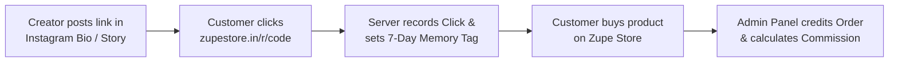
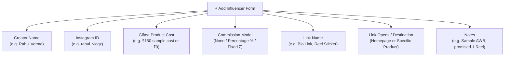

# Zupe Store — Influencer Orders & Affiliate Marketing Admin Guide

> **Welcome!** This guide is written in clear, plain language so that anyone on the store team—even without technical or coding experience—can easily understand, manage, and scale influencer affiliate partnerships on Zupe Store.

---

## 1. What is the Influencer Affiliate System?

Influencer marketing allows Zupe Store to collaborate with Instagram creators, YouTubers, and bloggers to promote products. 

Instead of paying high upfront promo fees without knowing if they will bring sales, Zupe Store gives each creator a **custom tracking link** (e.g., `zupestore.in/r/ijas`).

### Key Advantages:
1. **Zero Guesswork:** You see the exact number of clicks, orders, and revenue each creator brings in.
2. **7-Day Attribution Window:** If a customer clicks the link today on Instagram, leaves, and returns within 7 days to complete checkout, the creator still gets credit.
3. **Works for Both Payment Types:** Fully supports **Prepaid** (UPI, Cards, NetBanking) and **Cash on Delivery (COD)** orders.
4. **Automated Commission & ROI:** Tells you instantly how many times your investment returned (e.g. `10.0x Return`).

---

## 2. Understanding the Top KPI Cards

At the top of the **Influencer Orders** page, you see 6 summary cards that give you an instant snapshot of your affiliate marketing performance:

| Card Title | Example Value | What It Means in Plain English | How It is Calculated |
| :--- | :--- | :--- | :--- |
| **Influencers** | `3` *(3 active)* | Total creators registered in your system, and how many are currently active. | Count of all creators in the database. |
| **Total Clicks** | `2` | How many times customers have tapped on any creator link within the chosen date filter. | Sum of all logged clicks in the selected date range. |
| **Orders** | `3` | Total completed purchases brought in through creator links in the chosen date range. | Count of orders with attributed affiliate codes in that period. |
| **Attributed Revenue** | `₹2,697` | Total sales value (gross money) received from creator-driven customer orders. | `Order 1 (₹599) + Order 2 (₹599) + Order 3 (₹1,499) = ₹2,697`. |
| **Commission (Period)** | `₹269.7` | The total commission amount creators earned **strictly inside the selected date filter** (e.g. Last 7 Days). | Sum of commission calculated for orders placed in the selected dates: `₹59.9 + ₹59.9 + ₹149.9 = ₹269.7`. |
| **Total Pending (All-Time)** | `₹209.8` | **The actual money you owe to creators right now.** | `Total Lifetime Commission Ever Earned` minus `Total Money You Already Paid Out`. |

> [!IMPORTANT]
> **Why is "Total Pending" All-Time instead of Date-Filtered?**  
> Because unpaid commission is a business debt! If a creator brought sales two weeks ago and you haven't paid them yet, you still owe them that money today. The pending payout never resets or disappears just because you change your date filter to "Today" or "Yesterday".

---

## 3. Explaining Every Column in the Partner Performance Table

The main table lists each creator and breaks down their individual performance:

| Column Header | What It Represents | How It Works & Example |
| :--- | :--- | :--- |
| **NAME / INSTA ID** | Creator's name and Instagram username. | Clicking their username opens their Instagram profile. Clicking the small document icon opens your private notes for them. |
| **LINKS** | Number of active tracking links for this creator. | Clicking the arrow `v` expands a breakdown showing each individual link (e.g., Reel vs Story). |
| **CLICKS** | Number of times followers clicked this creator's link. | Increments each time someone visits their shortlink. |
| **ORDERS** | Completed orders generated by their link. | Increments automatically upon checkout completion. |
| **CONV %** *(Conversion Rate)* | Percentage of visitors who bought after clicking. | Formula: `(Orders ÷ Clicks) × 100%` *Example:* 1 order from 2 clicks = `(1 ÷ 2) × 100 = 50%`. |
| **REVENUE ₹** | Total sales money generated by this creator. | Sum of all customer order amounts brought by this creator. |
| **COMMISSION ₹** | Total commission earned by this creator in the selected timeframe. | Shows the commission rate beneath (e.g., `10%` or `Fixed ₹100`). |
| **PENDING ₹** | Money you currently owe to this creator. | Green `₹0` if fully settled; orange badge (e.g., `₹149.9`) if payment is pending. |
| **SPEND / RETURN** | Return on Investment (ROI) efficiency multiplier. | Tells you how many rupees of sales you made for every ₹1 spent on this creator. |
| **STATUS** | Current settlement state. | Shows **"Paid"** with last payment date or an orange **"Mark Paid"** button. |
| **ACTIVE** | ON/OFF switch for tracking. | Controls whether links actively record clicks and commissions. |
| **ACTIONS** | Management shortcuts. | `+` Add Link, ✏️ Edit details, 💬 Copy WhatsApp report. |

---

## 4. How "Spend" and "Return (ROI)" Are Calculated

To help you decide which influencers are profitable and which are losing you money, the system automatically computes **Spend** and **Return Multiplier**:

### Formula 1: Total Spend on Creator
$$\text{Spend} = \text{Gifted Product Cost} + \text{Commission Earned in Selected Period}$$

* **Example (Creator ijas):**
  * Gifted product cost: ₹0 (no free sample sent)
  * Commission earned: ₹149.90
  * **Total Spend:** `₹0 + ₹149.90 = ₹149.90`

* **Example (Creator Anu Sharma):**
  * Gifted product cost: ₹150 (Knife Sharpener sample)
  * Commission earned: ₹59.90
  * **Total Spend:** `₹150 + ₹59.90 = ₹209.90`

### Formula 2: Return Multiplier (ROI)
$$\text{Return Multiplier} = \frac{\text{Attributed Revenue}}{\text{Total Spend}}$$

* **Example (Creator ijas):**
  * Revenue: ₹1,499
  * Spend: ₹149.90
  * Calculation: `1499 ÷ 149.9 = 10.0x`
  * Meaning: **For every ₹1 spent on ijas, Zupe Store generated ₹10 in sales!**

### Visual Return Badges:
* 🟢 **Green (3.0x or higher):** Highly profitable campaign. Keep working with this creator!
* 🟡 **Amber (1.0x to 2.9x):** Profitable or breakeven. Worth continuing if product margins are healthy.
* 🔴 **Red (Below 1.0x):** Loss-making (you spent more on sample + commission than the sales brought in).

---

## 5. Guide to the "+ Add Influencer" Form

When creating a new partnership by clicking the orange **"+ Add Influencer"** button, here is what each field means:

### Detailed Field Explanations:

1. **Creator Name (Required):**
   * *What to enter:* The real name or public name of the creator (e.g. `Anu Sharma` or `ijas`).
   * *Why:* Used across your dashboard, payment records, and WhatsApp reports.

2. **Instagram Handle / ID (Required):**
   * *What to enter:* Their Instagram username **without** the `@` symbol (e.g. `_i__jas_` or `anu_mwyhvohu`).
   * *Why:* The system uses this handle to generate the shortlink code (e.g. `zupestore.in/r/_i__jas_`) and creates a 1-click link to view their profile.

3. **Gifted Product Cost (₹) (Optional):**
   * *What to enter:* The manufacturing/sourcing cost of any free product you shipped to them (e.g. `150`). If you did not send any free sample, leave it as `0`.
   * *Why:* Factor into the Return (ROI) math so you know if gifting the sample was worth it.

4. **Commission Model:**
   * **None (Barter / Free Product Only):**  
     Use this if the influencer agreed to post solely in exchange for the free product. No commission is tracked or owed per sale.
   * **Percentage (%) of Order Value (Recommended - Default 10%):**  
     The creator gets a set percentage of every sale they generate.
     * *Example:* If commission is 10%, a ₹1,499 order gives ₹149.90 commission; a ₹599 order gives ₹59.90.
   * **Fixed Amount (₹) per Order:**  
     The creator gets a flat rupee bounty per sale, regardless of the cart size (e.g. flat ₹100 per completed order).

5. **First Link Name:**
   * *What to enter:* A helpful label describing where they will share it (e.g. `Instagram Bio`, `Knife Sharpener Reel`, `Story Link`).

6. **Link Opens (Destination):**
   * *Choices:*
     * **Homepage (`zupestore.in`):** Recommended for bio links where the creator promotes your entire store.
     * **Product Dropdown (e.g. Knife Sharpener, Earbuds):** Select any product from your catalog. When followers tap the link, it opens that product's page immediately, boosting conversion rates!

7. **Notes (Optional):**
   * *What to enter:* Free-text notes for your records (e.g. `Sent sample via Shiprocket AWB 12345678 on 20 Nov. Agreed to 1 Reel + 2 Stories`).

---

## 6. How to Pay Creators ("Mark Paid" Workflow)

When you are ready to transfer money to a creator (via Google Pay, PhonePe, UPI, or Bank Transfer):

1. Look for creators with an orange **"Mark Paid"** button under the **STATUS** column.
2. Next to the button, the **PENDING ₹** column shows the exact balance owed (e.g. `₹149.90`).
3. Send the money to the creator using your payment app (Google Pay / UPI).
4. Click the orange **"Mark Paid"** button on the screen:
   * A settlement confirmation modal opens displaying the creator's name and amount.
   * (Optional) Enter a reference note: e.g. `"GPay UPI Ref 9876543210 on 27 Nov"`.
   * Click **"Confirm Payout"**.
5. **What happens immediately:**
   * Creator's Pending amount resets to **₹0**.
   * Status turns to green **"Paid"** with the payment date and amount stamped.
   * The top **"Total Pending (All-Time)"** card automatically reduces by that amount.
   * The payout is permanently logged in the database ledger for accounting.

---

## 7. The 1-Click WhatsApp Report Feature

Next to each creator in the **ACTIONS** column, click the **WhatsApp speech bubble icon** (💬).

The system instantly copies a ready-to-send update message to your clipboard:

> *"Hi ijas 👋 Your Zupestore link report (last 7 days): 2 clicks, 1 orders, commission ₹150. Thank you! 🙌"*

You can open WhatsApp Web or your phone, paste, and send it directly to the creator in 2 seconds. Creators love this transparency, and it motivates them to post more stories!

---

## 8. Summary FAQ for Store Admins

### Q1: What happens if I turn the "Active" toggle switch OFF?
**Answer:** The creator's links will still safely redirect customers to your store so no customer gets an error page, but the system **stops recording clicks and stops awarding commissions**. Use this if a creator's campaign contract has ended.

### Q2: Can one creator have multiple links?
**Answer:** Yes! Click the `+` icon under Actions to create extra links for the same creator (e.g., Link 1 for Instagram Bio to Homepage, Link 2 for Reel to Knife Sharpener). In the dashboard, you can see clicks and sales broken down per link.

### Q3: What if a customer clicks on their phone in the Instagram app?
**Answer:** The system uses both HTTP cookies and `localStorage` syncing specifically engineered for Instagram and Facebook in-app browsers, ensuring 100% reliable tracking even if Instagram restricts regular third-party cookies.
