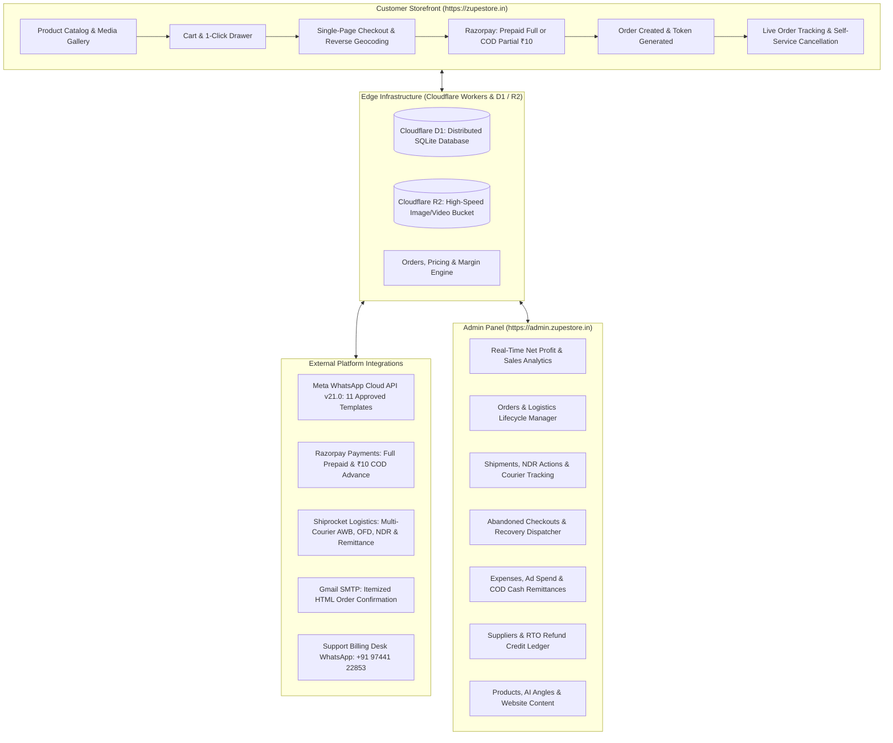
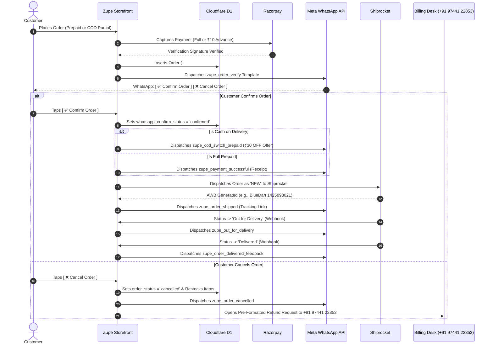

# Zupe Store — Complete Platform Workflow, Feature Guide & Integration Architecture

**Author:** Zupe Store Engineering & Operations Team  
**System:** Zupe Store D2C Dropshipping Storefront & Enterprise ERP  
**Live Production Storefront:** `https://zupestore.in`  
**Live Production Admin ERP:** `https://admin.zupestore.in`  
**Runtime Architecture:** Next.js (App Router), Cloudflare Workers, Cloudflare D1 (Distributed SQLite), Cloudflare R2 (Object Storage)  
**Document Version:** 4.0.0 (Production Verified)  

---

## 📌 Executive Overview & System Architecture

Zupe Store is a high-performance direct-to-consumer (D2C) e-commerce storefront paired with an enterprise-grade Dropshipping Enterprise Resource Planning (ERP) platform. Built natively for the Indian market, it solves the four foundational challenges of Indian D2C dropshipping:

1. **High Cash on Delivery (COD) Return-to-Origin (RTO):** Mitigated via mandatory ₹10 online partial payment commitment, automated WhatsApp interactive order verification (`zupe_order_verify`), and an instant ₹30 discount incentive to switch from COD to Prepaid (`zupe_cod_switch_prepaid`).
2. **Courier Remittance Latency:** Automated reconciliation of courier Cash Remittance Numbers (CRN) and Bank UTRs across Delhivery, BlueDart, Ekart, and Shadowfax via Shiprocket.
3. **Supplier RTO Credit Leakage:** Automated credit ledger that recovers unit product costs (COGS) into the supplier balance ledger upon package return to the supplier.
4. **Fragmented Profit Analytics:** Unified margin engine that combines Meta Ad spends, shipping charges, product COGS, and RTO fees to output real-time net profit per order.



---

## 👤 Part 1: Customer / User Complete End-to-End Workflow

This section outlines every feature available to a customer, following the exact chronological order from the moment they land on the website to post-delivery product reviews.

```
[ 1. Discovery ] ──► [ 2. Product Detail ] ──► [ 3. Cart / Bag ] ──► [ 4. Checkout ]
                                                                             │
┌────────────────────────────────────────────────────────────────────────────┘
▼
[ 5. Payment Selection: Full Prepaid vs COD Partial ₹10 ]
        │                                  │
        ▼ (Prepaid Captured)               ▼ (COD Advance Captured)
[ 6. Order Placed in D1 ] ────────► [ 7. WhatsApp Verification: Confirm or Cancel ]
                                           │
                        ┌──────────────────┴──────────────────┐
                        ▼ (Customer Clicks Confirm)           ▼ (Customer Clicks Cancel)
               [ 8. Confirmed in ERP ]               [ Cancellation Modal & Support ]
               (Prepaid: zupe_payment_successful)    (Redirect: +91 97441 22853)
               (COD: zupe_cod_switch_prepaid)                 │
                        │                                     ▼
                        ▼                             [ Auto Inventory Restock ]
               [ 9. Courier Dispatch via Shiprocket ]
               (In Transit ──► OFD ──► Delivered)
                        │
                        ▼
               [ 10. Post-Delivery 5-Star Review ]
```

### Step 1: Storefront Landing & Discovery
* **Hero Carousel & Banners:** Customer views high-resolution promotional banners managed dynamically from the admin panel.
* **Featured Collections & Video Showcase:** Embedded TikTok/Reels-style product demonstration videos with responsive autoplay and direct "Shop Now" hooks.
* **Category Navigation:** Intuitive browsing across Home Decor, Kitchen Accessories, Electronics, Personal Care, and Trending Deals.
* **Real-Time Live Search:** Sub-50ms instant fuzzy search querying product titles, tags, and categories.
* **Floating Quick Actions:** Wishlist counter, quick-cart drawer, and direct WhatsApp support trigger.

### Step 2: Product Detail Page (PDP) Experience
* **High-Definition Multi-Angle Media:** Image gallery supporting zoom, multi-angle renders, and video demonstrations stored in Cloudflare R2.
* **Real-Time Stock Counter:** Urgency trigger displaying real-time available stock (automatically decremented upon purchase).
* **Price & Savings Calculation:** Clear strike-through MRP, discounted selling price, and percentage saved tag.
* **COD Advance Badge:** Clear badge highlighting: *"Cash on Delivery Available (Pay only ₹10 advance to confirm delivery)"*.
* **Customer Reviews & Rating Breakdown:** Verified buyer star ratings, photo reviews, and rating distribution graphs.
* **Action Buttons:** Flexible choice between *"Add to Cart"* (adds item to drawer) and *"Buy Now"* (bypasses cart directly to single-page checkout).

### Step 3: Shopping Cart & 1-Click Drawer
* **Slide-Over Cart Drawer:** Non-intrusive slide-over drawer enabling instant quantity increment, decrement, and item removal without page reload.
* **Free Delivery Progress Indicator:** Dynamic progress bar showing how much more to add for free shipping (Free delivery unlocked across all products).
* **Promo Code Redemption:** Instant client and server validation of promo codes (percentage discounts or flat ₹ deductions) with live price updates.
* **Exit-Intent Capture:** If the customer closes the drawer after entering their phone or cart details, an abandoned checkout record is automatically created.

### Step 4: Streamlined Single-Page Checkout
* **Phone Login / Verification:** 
  * Customers can sign in using **WhatsApp OTP (`zupe_login_otp`)** with 1-tap copy code.
  * No password creation or account complexity required.
* **Smart Address Auto-Fill:** 
  * Entering a 6-digit Indian Postal PIN Code triggers auto reverse-geocoding for City and State.
  * Return customers have their saved delivery address pre-filled automatically.
* **Cart Abandonment Tracking:** As soon as a customer inputs their mobile number, a background record is registered in `abandoned_checkouts`. If the order is not placed within 15–30 minutes, automated recovery triggers.

### Step 5: Payment Method Selection
Customers select between two distinct fulfillment paths:

#### Option A: Full Prepaid Online Payment (Recommended — Extra ₹30–₹50 Instant Savings)
* **Discount Applied:** Automatically applies an extra instant discount on the order subtotal.
* **Gateway Launch:** Seamless Razorpay payment modal with UPI (Google Pay, PhonePe, Paytm, CRED), Credit/Debit Cards, NetBanking, and Wallets.
* **Zero Doorstep Cash:** Customer pays 100% upfront; zero collection needed at doorstep.

#### Option B: Cash on Delivery with ₹10 Partial Advance (Anti-RTO Protection)
* **Doorstep Balance Due:** Balance payable at delivery is `Total Amount - ₹10 Advance Paid`.
* **The ₹10 Advance Payment:** Customer pays ₹10 securely online via Razorpay UPI to verify intent and phone authenticity.
* **Shipping Fee:** ₹49 shipping charge added transparently to COD orders.

### Step 6: Order Placement & Secure Record Creation
1. Razorpay signature is cryptographically verified by [`/api/razorpay/verify-payment`](file:///c:/Users/ijas1/OneDrive/Desktop/zupe-store-ecommerce/src/app/api/razorpay/verify-payment/route.ts).
2. The order is stored in Cloudflare D1 with a unique sequential order ID (e.g., `#1941`).
3. An encrypted one-time verification token (`whatsapp_confirm_token`) is generated.
4. Inventory stock is decremented atomically in D1.
5. Abandoned checkout records for that phone number are automatically marked as `recovered`.

### Step 7: Automated Interactive WhatsApp Pre-Confirmation
Within seconds of placing the order, the customer receives Meta template **`zupe_order_verify`** on WhatsApp containing:
* First Name, Sequential Order ID, Product Name, Amount Payable, and Amount Paid.
* **Button 1: `[ ✅ Confirm Order ]`** — Links to secure 1-tap confirmation.
* **Button 2: `[ ❌ Cancel Order ]`** — Links to the storefront order portal with an active cancellation confirmation prompt.

### Step 8: Order Confirmation & Discount Switch
When the customer clicks `[ ✅ Confirm Order ]`:
* **For COD Orders:** 
  * The order status changes to `Confirmed` and `Processing`.
  * Meta template **`zupe_cod_switch_prepaid`** is instantly delivered on WhatsApp offering flat **₹30 OFF** if they switch to prepaid now.
  * Features two buttons: `[ Pay Now & Save Rs 30 ]` and `[ Track Order ]`.
* **For Prepaid Orders:**
  * Meta template **`zupe_payment_successful`** is dispatched with official payment receipt and `[ 📦 View Order ]` button.
* **Email Notification:** If the customer provided an optional email, an itemized HTML confirmation email is sent via Gmail SMTP.

### Step 9: Courier Dispatch & Live Real-Time Tracking
* Customers can track their package at any time via `https://zupestore.in/order-tracking` using either their Order ID (e.g., `#1941`) or Courier AWB number.
* Interactive visual stepper indicates:
  1. *Order Placed & Confirmed*
  2. *Packed & Handed Over to Courier (AWB Generated)* → Triggers **`zupe_order_shipped`**
  3. *In Transit (Inter-City Movement)*
  4. *Out for Delivery (Rider Dispatched)* → Triggers **`zupe_out_for_delivery`**
  5. *Delivered* → Triggers **`zupe_order_delivered_feedback`**

### Step 10: Cancellation, Refund & Customer Review
* **Self-Service Order Cancellation:** If cancelled prior to dispatch, the order is marked `cancelled` in D1 and inventory is immediately restocked.
* **Support Billing Desk Redirect:** For orders with captured payments (₹10 COD advance or Prepaid full), the customer is presented with an automated 1-click WhatsApp redirect to Billing Desk Support (**`+91 97441 22853`**) with all order ID, payment ID, and UPI refund details pre-formatted.
* **Post-Delivery Product Reviews:** Upon package delivery, WhatsApp review template opens PDP review modal allowing star ratings, written feedback, and photo uploads.

---

## 🛠️ Part 2: Admin Dashboard Features & Operational Capabilities

Accessible securely on the dedicated subdomain `https://admin.zupestore.in` with session cookie authentication and route-level protection.

```
┌────────────────────────────────────────────────────────────────────────┐
│                        ZUPE STORE ADMIN ERP PANEL                      │
└────────────────────────────────────────────────────────────────────────┘
  ├── [1] Executive Dashboard & Net Profit Real-Time Analytics
  ├── [2] Orders & Logistics Lifecycle Manager (AWB, Shiprocket Sync)
  ├── [3] Shipments, Tracking & NDR Management
  ├── [4] Abandoned Checkouts Recovery Center
  ├── [5] Product Catalog, COGS & AI Multi-Angle Generator
  ├── [6] Promo Codes & Discount Rule Engine
  ├── [7] Website Content, Banners & Video Showcase Manager
  ├── [8] Suppliers Directory & COGS Allocation
  ├── [9] Operational Expenses & Meta Ad Spend Manager
  ├── [10] COD Cash Remittances & Bank Reconciliation
  ├── [11] Supplier RTO Credit & Refund Ledger
  ├── [12] Dropship Unit Economics Profit Calculator
  ├── [13] Customer Database & Lifetime Value (LTV)
  ├── [14] Customer Reviews & Moderation Center
  ├── [15] Financial Reports, P&L Statements & CSV Exports
  └── [16] System Settings, API Keys & Integration Health
```

### Module 1: Executive Dashboard & Net Profit Analytics
* **Real-Time Financial KPI Cards:**
  * **Gross Merchandise Value (GMV):** Total collected and pending order value.
  * **Net Profit & Net Margin %:** Pure bottom-line profit calculated after deducting Product Cost (COGS), Forward Shipping, RTO reverse freight, Meta Ad Spends, and Operational Overheads.
  * **Total Orders & Average Order Value (AOV):** Active order metrics across time filters.
  * **RTO Rate % & NDR Rate %:** Live operational risk percentages.
* **Date Range Filters:** 1-Click switching between *Today, Yesterday, This Week, This Month, Last Month, Year-to-Date (YTD),* or Custom Date Ranges.
* **Profit Trend Graphs:** Visual revenue vs cost vs net profit area charts.
* **Courier Distribution & Delivery Performance:** Breakdown of shipments by courier partner (Delhivery, BlueDart, Shadowfax, Xpressbees).

### Module 2: Orders & Logistics Lifecycle Management
* **Comprehensive Orders Data Grid:** Displays Order ID, Date, Customer Name, Phone, Delivery Status, Payment Method, Selling Price, Net Profit, Courier Partner, and AWB Number.
* **WhatsApp Confirmation Status Badges:** Visual indicator showing whether an order is `Awaiting WA Confirmation` (yellow) or `✓ WA Confirmed` (green).
* **Manual Verification & Admin Overrides:**
  * Admin can manually confirm an order with 1 click if a customer calls or confirms over phone.
  * Admin can trigger on-demand WhatsApp verification messages directly from the actions menu.
* **Shiprocket Integration Sync Button:** 1-Click *"Sync Shiprocket"* queries the Shiprocket Live Tracking API to update statuses across all open shipments in under 2 seconds.
* **CSV Export:** Full order dataset export compatible with Microsoft Excel and Google Sheets.

### Module 3: Shipments & Non-Delivery Report (NDR) Management
* **Carrier Tracking & Status Categorization:** Separates orders into *Awaiting Pickup, In Transit, Out for Delivery, Delivered, NDR (Delivery Attempt Failed),* and *RTO*.
* **NDR Recovery Action Center:**
  * Highlights delivery exceptions (Customer unavailable, Incorrect address, Cash not ready).
  * 1-Click dispatch of WhatsApp reschedule prompt (`zupe_delivery_attempt_failed`).
  * Direct re-attempt request submission to Shiprocket API.

### Module 4: Abandoned Checkouts Recovery Center
* **Live Funnel Monitoring:** Captures shoppers who reached checkout and entered their contact details but did not complete payment.
* **Automated Cron Engine:** Edge cron (`/api/cron/abandoned-checkouts`) evaluates abandoned checkouts aged 15–30 minutes and dispatches WhatsApp recovery template `zupe_abandoned_cart`.
* **1-Click Manual Recovery Dispatch:** Admin can manually trigger recovery WhatsApp messages with dynamic discount incentives directly from the dashboard.
* **Recovery Attribution:** Tracks which recovered orders successfully converted back into sales.

### Module 5: Products, COGS & AI Multi-Angle Generator
* **Product Catalog Management:** Create, edit, and publish products with title, price, cost price (COGS), stock quantity, category, and specifications.
* **AI Product Multi-Angle Studio:** Integrated Python/AI script generator that produces photorealistic multi-angle renders (front, 45-degree isometric, top, and lifestyle context) stored in Cloudflare R2.
* **Inventory Stock Alerts:** Real-time badge indicators for low stock and out-of-stock items.

### Module 6: Promo Codes & Discount Rule Engine
* **Promo Code Creation:** Set custom coupon codes (e.g., `ZUPE30`, `FESTIVE10`).
* **Discount Types:** Flat rupee discount or percentage discount.
* **Rules & Constraints:** Minimum order value requirement, start/expiry dates, maximum total redemptions, and active toggle.

### Module 7: Website Content & Storefront Styling Manager
* **Hero Carousel Banners:** Upload, re-order, and link homepage promotional banners directly to Cloudflare R2.
* **Category Card Customization:** Set display images, titles, and routing slugs for storefront categories.
* **Showcase Collections:** Define featured collections and product highlights on the homepage.
* **Social Proof Badges:** Manage verified trust badges and counter stats displayed in the storefront footer.

### Module 8: Suppliers Directory & COGS Allocation
* **Supplier Profiles:** Manage dropshipping supplier contacts, payment terms, and assigned SKUs.
* **Unit Cost Tracking:** Map unit purchase prices (COGS) to calculate order-level profit margins automatically.

### Module 9: Operational Expenses & Meta Ad Spend Manager
* **Expense Ledger:** Record daily Meta Ads spend, influencer marketing fees, software subscriptions, packaging, and custom overheads.
* **Ad Spend Allocation:** Automatically distributes daily Meta Ad spend across orders generated on that date to compute true customer acquisition cost (CAC).

### Module 10: Payments & COD Cash Remittance Reconciliation
* **Courier Remittance Reconciliation:** Track COD cash collections remitted to the business bank account by couriers via Shiprocket.
* **CRN & Bank UTR Tracking:** Match courier payment advice notes against bank statements to eliminate locked or missing cash.

### Module 11: Supplier RTO Refund & Credit Ledger
* **Automated Supplier Credit Ingestion:** When an RTO package is confirmed delivered back to the supplier via Shiprocket webhook, the system automatically creates a credit entry for the unit product cost.
* **RTO Ledger Balance:** Displays cumulative supplier credit owed to Zupe Store, preventing margin loss on returned items.

### Module 12: Dropship Unit Economics Profit Calculator
* **Interactive Margin Simulator:** Simulates profitability before launching products.
* **Inputs:** Selling Price, COGS, Forward Freight, Expected RTO %, Return Freight, Target Meta CPA.
* **Outputs:** Gross Margin, Expected Net Profit per Unit, Break-Even ROAS, and Cash Flow projection.

### Module 13: Customer Database & Lifetime Value (LTV)
* **Customer Profiles:** Unified customer view with phone, email, delivery addresses, total orders placed, and lifetime spend.
* **Order History Linkage:** 1-Click view of all past orders placed by any customer.

### Module 14: Customer Reviews & Moderation Center
* **Review Moderation:** Approve, reject, or edit customer-submitted reviews before they appear live on the storefront PDP.
* **Verified Buyer Badges:** Automatically marks reviews from customers who purchased the product as *"Verified Buyer"*.

### Module 15: Financial Reports, P&L Statements & CSV Exports
* **Income Statements:** Generate formal Profit & Loss statements for any month or year.
* **Tax & Shipping Summaries:** Breakdowns of collected shipping charges, discounts granted, and supplier payouts.

### Module 16: System Settings & Integration Diagnostics
* **Live Integration Health Monitor:** Diagnostics for Meta Cloud API, Shiprocket API, Razorpay API, Cloudflare D1, and SMTP service.
* **Admin Security:** Change admin credentials and manage session timeouts.

---

## 🔄 Part 3: Real-Time Data Synchronization Architecture

The platform operates on a synchronized triangle between the **Customer Storefront**, **Cloudflare Distributed Edge Storage**, and the **Admin ERP Panel**.

```
┌────────────────────────┐                    ┌────────────────────────┐
│  CUSTOMER STOREFRONT   │                    │     ADMIN ERP PANEL    │
│  (https://zupestore.in)│                    │(admin.zupestore.in)    │
└───────────┬────────────┘                    └───────────┬────────────┘
            │                                             │
            │  1. Places Order / WhatsApp Confirm / OTP   │  4. Real-time Polling (10s)
            │  2. Token Verification / Cancellation       │  5. Status Overrides & Edits
            │  3. Inventory Stock Deduction               │  6. Expense & Supplier Entry
            ▼                                             ▼
  ┌───────────────────────────────────────────────────────────────┐
  │         CLOUDFLARE EDGE DATABASE (D1 Distributed SQLite)      │
  │     - orders (Status, AWB, Delivery, WA Confirm, Profits)     │
  │     - products (Inventory, Prices, R2 Media URLs)             │
  │     - abandoned_checkouts (Tokens, Recovered Status)          │
  │     - expenses, remittances, rto_credits, suppliers           │
  └───────────────────────────────┬───────────────────────────────┘
                                  │
                                  │  Webhooks & API Sync
                                  ▼
      ┌───────────────────────────────────────────────────────┐
      │             EXTERNAL INTEGRATION PLATFORMS            │
      │   Meta WhatsApp Cloud API | Shiprocket | Razorpay     │
      └───────────────────────────────────────────────────────┘
```

### 1. Storefront to Admin Synchronization
* **Instant Order Propagation:** When an order is placed on `zupestore.in`, it writes directly to Cloudflare D1. The admin panel (`admin.zupestore.in`) polls every 10 seconds and automatically updates the order count, revenue metrics, and order table without requiring a browser refresh.
* **Real-Time WhatsApp Badge Sync:** When a customer taps `[ ✅ Confirm Order ]` inside WhatsApp on their mobile phone, the edge endpoint `/api/orders/whatsapp-confirm` locks in `whatsapp_confirm_status = 'confirmed'`. The admin panel reflects the green `✓ WA Confirmed` badge within seconds.

### 2. Admin to Storefront Synchronization
* **Inventory Stock Decrement & Restock:**
  * When an order is placed, stock is atomically decremented.
  * If an order is cancelled by the customer or admin, the system automatically executes `restockInventory()` in D1, immediately restoring the item for purchase on the storefront.
* **Website Content & Banners:** Updates made to banners or promotional collections in the admin panel are immediately reflected on the storefront homepage via edge cache revalidation.

### 3. Subdomain Security & Routing Separation
* Storefront traffic (`https://zupestore.in`) is served with public access and client-optimized caching.
* Admin traffic (`https://admin.zupestore.in`) is enforced by edge middleware that rejects non-authenticated sessions, redirects unauthenticated requests to `/admin/login`, and prevents any admin routes from leaking to storefront search engine crawlers (`robots.txt: Disallow /admin`).

---

## 🔌 Part 4: External Platform Integrations Matrix

This section defines the exact role, trigger events, and timing of every third-party platform integrated with Zupe Store.



---

### Detailed Integration Specification Table

| Platform | Primary Purpose | Trigger Events | Trigger Timing | Technical Payload / Method |
|---|---|---|---|---|
| **Meta WhatsApp Business Cloud API** | Customer Lifecycle, OTPs, Order Confirmations, Courier Tracking, NDR, Reviews | Checkout, Confirmation, Shipping, NDR, Delivery, Cancellation | **Instant (<2 seconds)** across all 11 approved templates | Graph API v21.0 HTTP POST via Phone ID `1434769426379176` |
| **Razorpay Payment Gateway** | Online payment collection for 100% Prepaid and ₹10 Partial COD advance | Customer clicks *"Complete Order"* at checkout | **Real-time** during checkout session | Razorpay Checkout SDK + HMAC-SHA256 signature verification |
| **Shiprocket Logistics Aggregator** | Courier assignment (Delhivery, BlueDart, Ekart), AWB generation, live tracking | Order confirmed via WhatsApp or manual admin dispatch | Automated immediately upon confirmation or on-demand | REST API v1 (`/v1/external/orders/create/adhoc`) & Webhooks (`/api/webhooks/shiprocket`) |
| **Shiprocket NDR Webhook** | Automated recovery when courier fails delivery attempt | Courier logs delivery failure (Customer unavailable, wrong address) | **Immediate** when carrier submits NDR event | Ingested via `/api/webhooks/shiprocket`, triggers `zupe_delivery_attempt_failed` |
| **Shiprocket Remittance Webhook** | COD cash reconciliation to bank account | Courier settles collected cash (weekly/bi-weekly) | Upon courier remittance generation | Ingested into `remittances` table with CRN & UTR |
| **Cloudflare D1 & R2** | Distributed SQL storage and media asset CDN | Every storefront interaction, image upload, order write | **Sub-5ms** global edge execution | Cloudflare D1 SQLite bindings & R2 S3-compatible object API |
| **Gmail SMTP Service** | Itemized HTML order confirmation emails | Order confirmation when customer provides optional email | Immediately after WhatsApp verification | TLS Port 465 via `smtp.gmail.com` with App Password authentication |
| **WhatsApp Support Billing Desk** | Customer refund handling for cancelled orders | Customer clicks *"Cancel Order"* on portal | Immediate redirect on cancellation | Deep-link to `https://wa.me/919744122853` with pre-filled order details |
| **Shopify Outbound Sync** | Multi-channel order mirroring and warehouse sync | When new order is placed and confirmed | Background async queue | Shopify Admin API (`/admin/api/2024-01/orders.json`) |

---

## 📱 Part 5: Master WhatsApp 11-Template Lifecycle Reference

All 11 message templates are officially **Approved & Active** in Meta Business Manager under the **Utility**, **Marketing**, and **Authentication** categories, delivering unconditionally to any Indian mobile number without 24-hour window restrictions.

| # | Template Name | Category | Exact Trigger Timing | Body Variables Passed | Interactive Buttons & Destination |
|---|---|---|---|---|---|
| **1** | `zupe_order_verify` | Utility | Immediate on order placement (COD & Prepaid) | `{{1}}` Name, `{{2}}` Order ID, `{{3}}` Product, `{{4}}` Due at Delivery, `{{5}}` Paid Online | `[ ✅ Confirm Order ]` → `/api/orders/whatsapp-confirm?token={tok}`<br>`[ ❌ Cancel Order ]` → `/orders?cancelPrompt={orderId}` |
| **2** | `zupe_cod_switch_prepaid` | Marketing | Immediate when COD order confirmed | `{{1}}` Name, `{{2}}` Clean Order ID, `{{3}}` Original COD Due, `{{4}}` Discounted Prepaid Price | `[ Pay Now & Save Rs 30 ]` → `/checkout?method=prepaid&switch=cod&orderId={id}`<br>`[ Track Order ]` → `/order-tracking?query={id}` |
| **3** | `zupe_payment_successful` | Utility | Immediate when prepaid payment captured | `{{1}}` Name, `{{2}}` Clean Order ID, `{{3}}` Total Paid | `[ 📦 View Order ]` → `/orders?query={id}` |
| **4** | `zupe_abandoned_cart` | Marketing | 15–30 mins after customer leaves checkout | `{{1}}` Name, `{{2}}` First Abandoned Product Name | `[ 🛒 Complete Your Order ]` → `/checkout?recover={token}` |
| **5** | `zupe_order_shipped` | Utility | Immediate when Shiprocket assigns AWB | `{{1}}` Name, `{{2}}` Order ID, `{{3}}` Courier Partner, `{{4}}` AWB Number, `{{5}}` Tracking URL | `[ 🔎 Track Shipment ]` → `/order-tracking?awb={awb}` |
| **6** | `zupe_out_for_delivery` | Utility | Immediate when courier status is OFD | `{{1}}` Name, `{{2}}` Clean Order ID, `{{3}}` Cash Due at Doorstep | `[ 🛵 Live Track ]` → `/order-tracking?query={id}` |
| **7** | `zupe_delivery_attempt_failed` | Utility | Immediate on courier delivery failure (NDR) | `{{1}}` Name, `{{2}}` Clean Order ID, `{{3}}` Product Name | Freeform customer reply prompt to update address or reschedule |
| **8** | `zupe_order_delivered_feedback` | Utility | Immediate when package marked Delivered | `{{1}}` Name, `{{2}}` Product Name, `{{3}}` Review URL | `[ ⭐ Leave a Review ]` → `/products/{slug}#reviews` (Opens 5-star popup) |
| **9** | `zupe_order_cancelled` | Utility | Immediate upon order cancellation | `{{1}}` Name, `{{2}}` Order ID, `{{3}}` Product, `{{4}}` Total Amount, `{{5}}` Refund Policy Note | Informs customer of cancellation and refund status |
| **10** | `zupe_refund_update` | Utility | Immediate when admin marks refund complete | `{{1}}` Name, `{{2}}` Clean Order ID, `{{3}}` Refund Amount, `{{4}}` Status (Processed) | `[ 🔎 View Order Status ]` → `/orders?query={id}` |
| **11** | `zupe_login_otp` | Authentication | Instant (<2s) on customer signin / OTP request | `{{1}}` 6-Digit Verification Code | `[ Copy Code ]` → 1-tap clipboard copy |

---

## 🔒 Part 6: System Reliability, Fallbacks & Error Handling

To ensure uninterrupted operations under high traffic:
1. **Serverless Worker Cold Starts:** Database connections and WhatsApp configurations are lazily resolved with fallback defaults so API calls never fail during cold boots.
2. **Meta Cloud API Fallbacks:** If an interactive button template encounters a temporary Meta network timeout, the system automatically falls back to an itemized direct text message formatting.
3. **Shiprocket Timeout Protection:** Orders pushed to Shiprocket are wrapped in a 3.5-second timeout race guard, guaranteeing that slow carrier API responses never hang the customer checkout experience.
4. **Token Security:** WhatsApp confirmation tokens (`whatsapp_confirm_token`) are strictly one-time use, preventing duplicate confirmation triggers from multiple button taps.
5. **Inventory Consistency:** Stock counts are managed atomically in SQLite transactions to eliminate overselling during promotional traffic surges.

---

*This document serves as the single source of truth for the Zupe Store e-commerce platform and dropshipping enterprise ERP architecture.*
