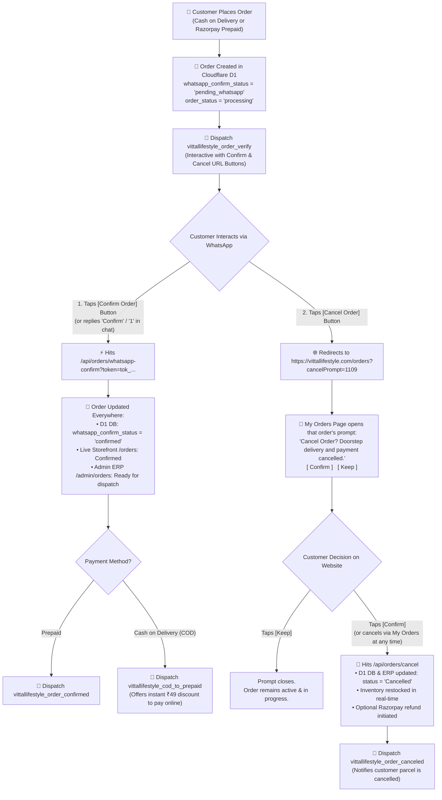

# Vittal Lifestyle — Complete WhatsApp Templates & Order Lifecycle Workflow Guide

This document is the official, comprehensive reference for the WhatsApp messaging architecture, Meta Business Manager template configurations, interactive button flows, and order state synchronization across the **Vittal Lifestyle** e-commerce platform.

---

## 1. Executive Architecture Overview

* **Store Brand:** Vittal Lifestyle (`https://vittallifestyle.com`)
* **Admin ERP:** `https://admin.vittallifestyle.com`
* **Messaging Engine:** Meta WhatsApp Cloud API (Graph API v21.0)
* **Database:** Cloudflare D1 Serverless SQL (`vittallifestyle-db`)
* **Live Inbound Webhook Endpoint:** `https://vittallifestyle.com/api/webhooks/whatsapp`
* **Webhook Verification Token:** `vittallifestyle_wa_secret_2026`

---

## 2. Meta Business Manager Templates Registry

The store operates on **5 official templates** registered in Meta Business Manager (`business.facebook.com/latest/whatsapp_manager/message_templates`):

| # | Template Name | Category | Language | Status | Primary Purpose |
|---|---------------|----------|----------|--------|-----------------|
| 1 | `vittallifestyle_otp` | `AUTHENTICATION` | English (`en`) | **Active** | 6-digit login & verification code |
| 2 | `vittallifestyle_order_verify` | `UTILITY` | English (`en`) | **Active / In Review** | Order pre-confirmation with Confirm & Cancel buttons |
| 3 | `vittallifestyle_order_confirmed` | `UTILITY` | English (`en`) | **Active** | Prepaid order confirmation & packing notice |
| 4 | `vittallifestyle_cod_to_prepaid` | `MARKETING` | English (`en`) | **Active** | COD order confirmation + switch to online discount |
| 5 | `vittallifestyle_order_canceled` | `UTILITY` | English (`en`) | **Active** | Order cancellation notice (COD & Prepaid) |

---

## 3. Template Specifications & Variable Mappings

### Template 1: `vittallifestyle_otp`
* **Category:** Authentication
* **Body:**
  ```text
  {{1}} is your verification code. For your security, do not share this code.
  ```
* **Variables:**
  * `{{1}}` = 6-digit OTP (e.g., `492018`)
* **Buttons:** Copy Code button (Preset by Meta Authentication standard)

---

### Template 2: `vittallifestyle_order_verify` (Core Verification)
* **Category:** Utility
* **Body Text:**
  ```text
  Hi {{1}}! 👋🏻

  😊 Thank you for ordering from Vittal Lifestyle 🛒

  ⁉️ Please confirm your order 📦

  📦 Order ID: {{2}}
  🛍️ Product: {{3}}
  💰 Amount Payable: ₹{{4}}
  💰 Amount Paid: ₹{{5}}

  📣 Please confirm whether you would like to proceed with your order. 💬

  Thank you, ❤️
  Team Vittal Lifestyle
  ```
* **Variables Mapping:**
  * `{{1}}` = Customer First Name (e.g., `Muhammed`)
  * `{{2}}` = Order ID (e.g., `#1109`)
  * `{{3}}` = Product Name or Summary (e.g., `2x Royal Saudi Medjool Glossy Dates (500g)`)
  * `{{4}}` = Amount Payable (e.g., `1,747` for COD, or `0` for Prepaid)
  * `{{5}}` = Amount Paid (e.g., `0` for standard COD, or `1,747` for Prepaid)
* **Buttons (Type: Visit Website / Dynamic URL):**
  * **Button 1 (Confirm Order):**
    * Type of action: `Visit website`
    * Button text: `Confirm Order`
    * URL type: `Dynamic`
    * Website URL: `https://vittallifestyle.com/api/orders/whatsapp-confirm?token={{1}}`
    * Sample URL: `https://vittallifestyle.com/api/orders/whatsapp-confirm?token=tok_sample_12345`
  * **Button 2 (Cancel Order):**
    * Type of action: `Visit website`
    * Button text: `Cancel Order`
    * URL type: `Dynamic`
    * Website URL: `https://vittallifestyle.com/orders?cancelPrompt={{1}}`
    * Sample URL: `https://vittallifestyle.com/orders?cancelPrompt=1109`

---

### Template 3: `vittallifestyle_order_confirmed` (Prepaid Confirmed)
* **Category:** Utility
* **Trigger:** Dispatched immediately when a **Prepaid** order is confirmed.
* **Body Text:**
  ```text
  Hi {{1}}! Thank you for shopping with Vittal Lifestyle! 🛍️

  Your prepaid order #{{2}} of Rs {{3}} has been confirmed and submitted for packing & express dispatch.

  🚚 Estimated Delivery: 5–7 Business Days
  🛡️ Genuine Quality Verification Seal Included
  ```
* **Variables Mapping:**
  * `{{1}}` = Customer First Name
  * `{{2}}` = Clean Order Number (e.g., `1109`)
  * `{{3}}` = Amount (e.g., `1,747`)
* **Button:**
  * Type: `Visit website` (Dynamic URL)
  * Button text: `Track Order`
  * Website URL: `https://vittallifestyle.com/order-tracking?query={{1}}`

---

### Template 4: `vittallifestyle_cod_to_prepaid` (COD Confirmed + Switch Offer)
* **Category:** Marketing
* **Trigger:** Dispatched immediately when a **Cash on Delivery (COD)** order is confirmed.
* **Body Text:**
  ```text
  Hi {{1}}! Your Cash on Delivery (COD) order #{{2}} of Rs {{3}} is confirmed! ⚡

  💡 Want Free Delivery & Express Dispatch?
  Pay online now to save Rs 49 on shipping fees and get priority courier handling.
  ```
* **Variables Mapping:**
  * `{{1}}` = Customer First Name
  * `{{2}}` = Clean Order Number (e.g., `1109`)
  * `{{3}}` = Total Amount (e.g., `1,747`)
* **Button:**
  * Type: `Visit website` (Dynamic URL)
  * Button text: `Pay Online (Save ₹49)`
  * Website URL: `https://vittallifestyle.com/checkout?switch_order={{1}}`

---

### Template 5: `vittallifestyle_order_canceled` (Order Cancellation)
* **Category:** Utility
* **Trigger:** Dispatched whenever an order is cancelled (via WhatsApp Cancel button -> Website Confirm, or directly from the My Orders page).
* **Body Text:**
  ```text
  Hi {{1}}! Your order #{{2}} has been successfully cancelled.

  📦 Status: Shipment cancelled. No payment will be collected at your doorstep.

  If you need any assistance or wish to re-order, our team is always here to help.

  Thank you,
  Team Vittal Lifestyle
  ```
* **Variables Mapping:**
  * `{{1}}` = Customer First Name (e.g., `Muhammed`)
  * `{{2}}` = Clean Order ID without hash (e.g., `1109`, since `#` is already in the template body)

---

## 4. Complete End-to-End Workflow Diagram



---

## 5. Technical Implementation & Button Mechanics

### 1. The `[Confirm Order]` Button Flow
* **URL:** `https://vittallifestyle.com/api/orders/whatsapp-confirm?token=<SECURE_TOKEN>&orderId=<ORDER_ID>`
* **Handler:** `src/app/api/orders/whatsapp-confirm/route.ts`
* **What happens behind the scenes:**
  1. Validates the verification token against the Cloudflare D1 database.
  2. Runs `confirmWhatsAppOrder()`:
     - Sets `whatsapp_confirm_status = 'confirmed'`.
     - Sets `whatsapp_token_used = 1`.
     - Sets `order_status = 'processing'`.
  3. Updates Cloudflare D1 SQL table `orders` and internal ERP cache in real-time.
  4. Automatically inspects `payment_method`:
     - If `prepaid`: Triggers `sendOrderConfirmationWhatsApp` -> calls `vittallifestyle_order_confirmed`.
     - If `cod`: Triggers `sendOrderConfirmationWhatsApp` -> calls `vittallifestyle_cod_to_prepaid`.
  5. Dispatches confirmation email if customer provided an optional email at checkout.
  6. Renders a clean, instantaneous green confirmation card to the user in their browser with a 1-click shortcut to track their order.

### 2. The `[Cancel Order]` Button Flow
* **URL:** `https://vittallifestyle.com/orders?cancelPrompt=<ORDER_ID>`
* **Handler:** `src/app/orders/page.tsx`
* **What happens behind the scenes:**
  1. The page detects `?cancelPrompt=<ORDER_ID>` in the URL parameters.
  2. If the user is unauthenticated or visiting on mobile, `/api/orders?orderId=<ORDER_ID>` loads that specific order automatically.
  3. It auto-scrolls to the order card and expands the cancellation prompt:
     ```text
     Cancel Order? Doorstep delivery and payment cancelled.
     [ Confirm ]    [ Keep ]
     ```
  4. If the user taps **`[Keep]`**:
     - Closes the banner; order continues processing smoothly.
  5. If the user taps **`[Confirm]`**:
     - Sends a `POST` request to `/api/orders/cancel`.
     - Marks the order as `Cancelled` in Cloudflare D1 and Admin ERP.
     - Automatically calls `restockInventory()` to return items back to available stock.
     - For prepaid orders, automatically initiates the Razorpay refund.
     - Dispatches the **`vittallifestyle_order_canceled`** WhatsApp message to the customer.

### 3. Automated Webhook Inbound Chat Listener
* **File:** `src/app/api/webhooks/whatsapp/route.ts`
* If a customer doesn't tap the button and instead replies directly in WhatsApp with:
  * **"Confirm Order"**, **"Confirm"**, **"1"**, **"Yes"**, or **"Proceed"**:
    * Webhook identifies the customer's phone number and finds their active order in `pending_whatsapp`.
    * Automatically confirms the order, marks D1, and replies with the confirmation template.
  * **"Cancel Order"**, **"Cancel"**, **"2"**, or **"No"**:
    * Automatically cancels the order, restocks inventory, and updates D1.

---

## 6. Codebase Reference Map

| Component / Function | File Path | Responsibility |
|----------------------|-----------|----------------|
| **Template Dispatcher** | `src/lib/whatsappOrderConfirmation.ts` | Formats variables and dispatches Meta Cloud API templates with graceful text fallbacks |
| **Order Confirmation Route** | `src/app/api/orders/whatsapp-confirm/route.ts` | Handles `[Confirm Order]` clicks, marks D1, dispatches follow-up template |
| **Order Cancellation Handler** | `src/app/api/orders/cancel/route.ts` | Executes order cancellations, updates D1, restocks items, dispatches cancel template |
| **Storefront Orders Page** | `src/app/orders/page.tsx` | Displays customer order history and renders the `[Confirm] / [Keep]` cancel prompt |
| **Order Store / DB Sync** | `src/lib/orderStore.ts` | Core state controller for `confirmWhatsAppOrder()` and `cancelWhatsAppOrder()` |
| **ERP Store / Profit Calculations** | `src/lib/erpStore.ts` | Manages live profit, COGS, and sync between memory and Cloudflare D1 |
| **WhatsApp Inbound Webhook** | `src/app/api/webhooks/whatsapp/route.ts` | Listens for delivery statuses and customer replies |
| **Admin Canned Templates** | `src/components/admin/whatsapp/QuickTemplatesModal.tsx` | Allows store admins to preview and send templates with 1 click from the Admin Desk |

---

## 7. Testing & Maintenance Best Practices

1. **Testing with Real Numbers:**
   * Meta Cloud API **strictly forbids** sending template or session messages from your business phone number to itself (`+91 9747 19 5000`).
   * Always place test orders using a real, separate mobile number (e.g., `+91 80897 32385`).
2. **Fallback Guarantee:**
   * If a template is temporarily `In Review` or rejected by Meta, the system automatically falls back to itemized direct WhatsApp messages containing the clickable `Confirm Order` and `Cancel Order` URLs. Customers will never miss an order verification.
3. **Cloudflare Deployment:**
   * Whenever updating WhatsApp logic, always run:
     ```powershell
     npm run build ; opennextjs-cloudflare build --dangerouslyUseUnsupportedNextVersion ; opennextjs-cloudflare deploy
     ```
   * Or use the npm shortcut: `npm run deploy`.
