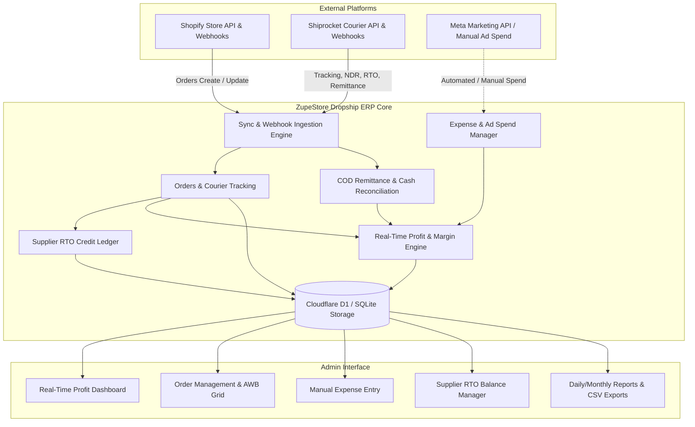

# Zupe Store — Dropshipping ERP & Financial Management System
## Software Requirements Specification (SRS) & System Architecture Document

**Document Version:** 1.0.0  
**Status:** Approved for Implementation  
**Client:** Zupe Store Management  
**System Name:** ZupeStore Dropship ERP  
**Target Environment:** Next.js (App Router), Cloudflare D1 / Workers, TailwindCSS, REST/Webhook APIs  

---

## 1. Executive Summary & Project Vision

### 1.1 Purpose
The **ZupeStore Dropship ERP** is a purpose-built, cloud-based operations and financial intelligence management system designed specifically for Indian direct-to-consumer (D2C) dropshipping. The system automates order synchronization from **Shopify**, monitors shipment, NDR, and RTO lifecycles in real time via **Shiprocket**, reconciles courier COD cash remittances, tracks operational expenses (including Meta Ads, shipping freight, and software), and delivers a real-time net profit dashboard.

### 1.2 Core Problem Solved
Traditional spreadsheets fail dropshippers because:
1. **COD Remittance Delays:** Cash on Delivery (COD) cash is locked in transit across courier networks for 7–14 days. Merchants struggle to calculate true cash-in-hand vs. pending receivables.
2. **RTO Margin Erosion:** Return-to-Origin (RTO) orders incur forward freight, reverse freight, and unrecoverable ad spend. Without automated supplier credit tracking, merchants lose track of supplier refunds for returned inventory.
3. **Fragmented Data:** Ad costs live in Meta Ads, orders in Shopify, deliveries in Shiprocket, and overheads in bank statements. Real-time net margin visibility is virtually impossible without unified data ingestion.

### 1.3 Key Architectural Distinction: Not Just an Excel Replacement
The system must automatically ingest data from external APIs and webhooks (Shopify & Shiprocket) while providing intuitive manual expense and payment entries, enforcing strict accounting logic, and computing order-level and store-level real-time net profitability.

---

## 2. Client Feature Priority Matrix

Based on the client's direct specifications, the system capabilities are categorized by priority:

| Feature / Capability | Priority Status | Primary System Module |
| :--- | :--- | :--- |
| **Shopify Order Synchronization** | **Essential** | Module 2: Orders & Module 7: Integrations |
| **Shiprocket Integration (AWB, Tracking, NDR, RTO)** | **Essential** | Module 2: Orders & Module 7: Integrations |
| **COD / Prepaid Payment Method Tracking** | **Essential** | Module 2: Orders & Module 4: Payments |
| **Order Status Tracking (Full Lifecycle)** | **Essential** | Module 2: Orders |
| **Delivered / RTO / NDR Status Tracking** | **Essential** | Module 2: Orders & Module 6: RTO Ledger |
| **Product Cost (COGS) Tracking** | **Essential** | Module 5: Products & Module 2: Orders |
| **Ad-Spend Tracking (Meta Ads)** | **Essential** | Module 3: Expenses & Module 1: Dashboard |
| **Manual Expense & Payment Entry** | **Essential** | Module 3: Expenses & Module 4: Payments |
| **Real-time Profit Calculation (Gross & Net)** | **Essential** | Module 1: Dashboard & Module 8: Reports |
| **Daily / Weekly / Monthly / Yearly Dashboard** | **Essential** | Module 1: Dashboard |
| **Cash Remittance Tracking (CRN / Bank UTR)** | **Essential** | Module 4: Payments |
| **Supplier-Wise RTO Refund Balance & Credit Ledger** | **Essential** | Module 6: RTO Refund Balance |
| **Mobile-Friendly Admin Panel (Responsive UI)** | **Essential** | Module 9: UI / UX Requirements |
| **Automated WhatsApp / SMS (NDR Recovery & Confirmations)** | **Very Useful** | Module 10: Value-Add Extensions |
| **Customer Database & Purchase History** | **Useful** | Module 10: Value-Add Extensions |
| **Inventory Management & Low-Stock Alerts** | **Useful** | Module 5: Products |
| **AI Reports / Prescriptive Insights** | **Optional** | Module 10: Value-Add Extensions |

---

## 3. System Architecture & External Integrations



### 3.1 Shopify Integration
- **Mechanism:** Webhooks (`orders/create`, `orders/updated`, `orders/cancelled`, `orders/fulfilled`) combined with automated REST/GraphQL sync.
- **Data Ingested:** Shopify Order ID, order date, customer name, email, phone number, shipping address, line items (product name, SKU, unit price, quantity), shipping charged to customer, discounts, taxes, and payment gateway (COD vs. Prepaid).
- **Fulfillment Writeback:** When Shiprocket assigns an AWB and courier partner, the ERP updates Shopify fulfillment with tracking number and tracking URL.

### 3.2 Shiprocket Integration
- **Mechanism:** Shiprocket REST API v1 (`/v1/external/orders/create/adhoc`, `/v1/external/courier/track/awb/`) and Shiprocket Webhooks.
- **Data Ingested:** Shiprocket Order ID, Shipment ID, AWB Code, Courier Partner Name (Delhivery, BlueDart, Xpressbees, Shadowfax, etc.), Forward Shipping Charges, Reverse Freight (RTO Charges).
- **Status Sync:**
  - Forward Delivery Status: `Manifested`, `Picked Up`, `In Transit`, `Out for Delivery`, `Delivered`.
  - NDR (Non-Delivery Report) Status: Customer unavailable, address incorrect, customer refused, door locked, OTP verification failed, re-attempt requested.
  - RTO Lifecycle: `RTO Initiated`, `RTO In Transit`, `RTO Delivered` (delivered back to hub/supplier).

### 3.3 Remittance & Courier Payment Synchronization
- **Mechanism:** Ingestion of Shiprocket Remittance / Settlement reports (CRN - Courier Remittance Number).
- **Data Ingested:** Total COD collected, courier freight deductions, net remitted amount, bank UTR, remittance date, settlement status (`Pending`, `Remitted`, `Disputed`).

### 3.4 Future / Optional Meta Ads Integration
- **Phase 1 (Immediate):** Daily manual ad spend entry categorized by date and campaign notes.
- **Phase 2 (Future):** Meta Marketing API integration fetching daily ad spend, impressions, clicks, and ROAS via System User Access Token.

---

## 4. Detailed Functional Module Requirements

### Module 1: Real-Time Profit Dashboard

The dashboard provides leadership with instant visibility into business health, sales performance, operational efficiency, and net profitability across any selected date range.

#### 1.1 Metrics & Key Performance Indicators (KPIs)
1. **Order Volume Metrics:**
   - **Total Orders:** Count of all placed orders.
   - **Confirmed Orders:** Orders approved and validated for dispatch.
   - **Shipped Orders:** Packages picked up by courier with active AWB.
   - **Delivered Orders:** Successful deliveries at customer doorstep.
   - **NDR Orders:** Orders with failed delivery attempts requiring action.
   - **RTO Orders:** Orders returned or returning to origin.
2. **Financial Revenue & Cost Metrics:**
   - **Total Sales (Gross Revenue):** Sum of selling price of all placed/confirmed orders.
   - **Product Costs (COGS):** Total supplier cost for shipped products.
   - **Shipping Costs:** Total forward shipping charges billed by Shiprocket.
   - **RTO Charges:** Reverse freight charges incurred on returned orders.
   - **Ad Spend:** Meta Ads and paid marketing expenses.
   - **Other Expenses:** Subscriptions, packaging, overheads, manual operational costs.
3. **Net Profitability Calculation Engine:**
   - **Gross Profit:**
     $$\text{Gross Profit} = \text{Total Delivered Revenue} - \text{Product Cost of Delivered Orders}$$
   - **Net Profit:**
     $$\text{Net Profit} = \text{Total Delivered Revenue} - (\text{Delivered Product Cost} + \text{Total Forward Shipping} + \text{Total RTO Reverse Freight} + \text{Ad Spend} + \text{Other Expenses}) + \text{Supplier RTO Credits}$$
   - **Profit Margin (%):**
     $$\text{Profit Margin} = \left(\frac{\text{Net Profit}}{\text{Total Delivered Revenue}}\right) \times 100$$
   - **RTO Percentage (%):**
     $$\text{RTO Percentage} = \left(\frac{\text{Total RTO Orders}}{\text{Total Shipped Orders}}\right) \times 100$$
4. **Cash Flow & Float Metrics:**
   - **COD Collected:** Total cash collected by courier delivery agents.
   - **COD Remitted:** Total cash credited to the merchant bank account with verified bank UTRs.
   - **Pending COD Remittance:** Unremitted cash float held by couriers awaiting settlement.
   - **Prepaid Settlements:** Total funds collected through online payment gateways.

#### 1.2 Timeframe Filtering
- Quick Filters: **Today**, **Yesterday**, **This Week**, **This Month**, **Year to Date (YTD)**, **All Time**.
- **Custom Date Range Picker:** Dual calendar selector (From Date $\rightarrow$ To Date) with instant recalculation.

#### 1.3 Graphical Visualizations
- Daily Revenue vs. Total Expenses vs. Net Profit multi-line area chart.
- Order Status Distribution doughnut chart (`Delivered`, `In Transit`, `NDR`, `RTO`, `Pending`).
- Ad Spend vs. Delivered Orders correlation bar chart.
- Courier Partner Performance comparison (Delivery Rate % and RTO Rate % per courier).

---

### Module 2: Orders Management & Courier Tracking

The orders module serves as the operational headquarters for customer service, dispatch tracking, and unit economics.

#### 2.1 Order Data Grid Fields
Every order record contains the following comprehensive attributes:
1. **Shopify Order ID:** (e.g., `#1058`, `#1059`) with direct hyperlink to Shopify Admin.
2. **Internal System ID:** Unique database identifier (`ord_...`).
3. **Order Date & Time:** Normalized timestamp with timezone localization (`DD MMM YYYY, hh:mm A`).
4. **Customer Information:** Full Name, Contact Phone Number (with direct WhatsApp link), Email, Shipping Address, City, State, Pincode.
5. **Product Details:** Item Name, SKU, Variant, Quantity.
6. **Selling Price (Gross):** Total amount charged to the buyer.
7. **Payment Method:** `COD` (Cash on Delivery) or `Prepaid`.
8. **Product Cost (COGS):** Supplier cost for the specific item(s).
9. **Shipping Cost:** Forward freight billed by Shiprocket.
10. **Order Status:** `Confirmed`, `Processing`, `Shipped`, `Delivered`, `Cancelled`, `RTO`.
11. **Shiprocket AWB Number:** Tracking code with direct link to Shiprocket tracking page.
12. **Delivery Status:** `Processing`, `In Transit`, `Out for Delivery`, `Delivered`, `NDR`, `RTO Initiated`, `RTO In Transit`, `RTO Delivered`.
13. **NDR Status:** Latest NDR reason (e.g., *Customer unavailable*, *Incorrect address*), attempt count, customer response, and re-attempt date.
14. **RTO Status:** RTO trigger date, return tracking status, and return confirmation indicator.
15. **Payment / Remittance Status:** `Pending Courier Remittance`, `Remitted to Bank`, `Settled (Prepaid)`, `Disputed`.
16. **Net Profit per Order:**
    - For **Delivered Orders**:
      $$\text{Net Profit} = \text{Selling Price} - \text{Product Cost} - \text{Shipping Cost} - \text{Attributed Ad Spend} - \text{Gateway Fee}$$
    - For **RTO Orders**:
      $$\text{Net Profit} = 0 - \text{Forward Shipping Cost} - \text{Reverse RTO Freight} - \text{Attributed Ad Spend} + \text{Supplier Product Credit}$$

#### 2.2 Operations & Filtering Features
- Global search across Order ID, Customer Name, Phone Number, AWB Number, and SKU.
- Multi-faceted filters: Delivery Status, Payment Mode, Courier Partner, Date Range, Remittance Status.
- Quick actions: Resend WhatsApp confirmation, Initiate NDR re-attempt, Mark Delivered, Assign Supplier.
- Export selected or filtered orders to CSV / Excel.

---

### Module 3: Expense Management (Manual Entry + Categorization)

Allows administrators to manually log business expenditures with instant attribution to profit calculations.

#### 3.1 Mandatory Expense Categories
1. **Meta Ads:** Daily or campaign-level marketing spend across Facebook & Instagram.
2. **Product Cost:** Bulk inventory procurement, sample orders, or supplier batch advance payments.
3. **Shiprocket / Shipping:** Courier wallet recharges, excess weight adjustments, or monthly freight invoices.
4. **RTO Charges:** Reverse freight charges, courier handling penalties for undelivered shipments.
5. **Software / Subscriptions:** Shopify platform fees, ERP hosting, domain renewals, WhatsApp API charges, marketing apps.
6. **Other Expenses:** Packaging boxes, bubble wrap, tapes, office supplies, freelance contractor charges, banking fees.

#### 3.2 Expense Form Specification
- **Expense Date:** Date of transaction (defaults to current date).
- **Category:** Dropdown selection matching the 6 mandatory categories.
- **Amount (₹):** Numeric positive value.
- **Vendor / Payee:** Name of recipient (e.g., *Meta Platforms*, *Shiprocket Logistics*, *PackSafe Corp*).
- **Reference / Invoice No.:** Optional tax invoice or transaction ID.
- **Notes / Description:** Compulsory narrative detailing the purpose of the expense.
- **Created By:** User identity log for audit tracking.

---

### Module 4: Payments & Cash Remittance Tracking

Reconciles COD cash flows collected by couriers with bank account settlements.

#### 4.1 Courier Remittance Lifecycle
```
[Courier Collects COD from Customer]
              ↓
[Remittance Batch Created (CRN ID Assigned)]
              ↓
[Shiprocket Deducts Freight Adjustments & TDS]
              ↓
[Net Amount Remitted to Bank via NEFT/RTGS]
              ↓
[Bank UTR Number Verified & Order Remittance Status Marked "Remitted"]
```

#### 4.2 Remittance Ledger Attributes
- **CRN ID:** Courier Remittance Number (e.g., `CRN-SR-20261001-842`).
- **Courier Partner:** Delhivery, BlueDart, Xpressbees, Shadowfax, etc.
- **Total COD Collected:** Gross cash collected at customer doorsteps.
- **Courier Charges Deducted:** Freight adjustments and reverse billing deducted at source.
- **Net Remitted Amount:** Actual cash deposited into the merchant's bank account.
- **Remittance Date:** Date funds were processed by the courier.
- **Bank UTR Number:** Unique Transaction Reference from banking portal for audit verification.
- **Orders Count:** Number of individual orders included in the remittance batch.
- **Settlement Status:** `Pending`, `Remitted`, `Disputed`.

---

### Module 5: Products & Supplier Cost Catalog

Manages item master data, supplier assignment, cost baselines, and product-level profitability.

#### 5.1 Product Attributes
- **Product Name:** User-facing item title matching Shopify catalog.
- **SKU (Stock Keeping Unit):** Unique product code.
- **Supplier Cost (COGS):** Base purchase price payable to the supplier per unit.
- **Selling Price:** Retail price listed on the storefront.
- **Supplier Assignment:** Association to a registered supplier (Supplier A, Supplier B, etc.).
- **Available Stock:** Virtual or dropship inventory count with low-stock warnings.

#### 5.2 Product Analytics & Metrics
- Total Orders Placed per Product.
- Total Units Sold.
- Gross Revenue Generated.
- Total Product Cost (COGS) Incurred.
- **Delivery Rate (%) & RTO Rate (%):** Allows immediate identification of loss-making products with abnormal return rates.
- **Net Product Profit:** Cumulative contribution margin after product costs, allocated freight, and returns.

---

### Module 6: RTO Refund Balance & Supplier Credit Management (Dedicated Module)

A dedicated, specialized accounting module designed specifically for dropshippers who source from suppliers under a return-to-supplier credit model.

#### 6.1 Business Workflow
When an order becomes RTO and is returned to the supplier:
1. The courier delivers the returned product package back to the supplier's warehouse.
2. The supplier inspects the package and accepts the return.
3. The supplier issues a product cost credit to the merchant.
4. The credited amount is recorded in the ERP under the **RTO Refund Balance** for that specific supplier.
5. When subsequent orders are placed with that supplier, the merchant applies this available credit balance to offset new product costs.
6. The system automatically deducts the applied credit from the supplier's balance and generates a double-entry ledger record.

#### 6.2 Financial Walkthrough & Numerical Example
| Step / Event | Transaction Description | Product Cost | RTO Credit Applied | Cash Payable to Supplier | Remaining Supplier RTO Balance |
| :--- | :--- | :--- | :--- | :--- | :--- |
| **0. Initial RTO** | Order #1058 RTO returned to Supplier A | ₹500 | Credited (+₹500) | ₹0 | **₹500** |
| **1. Order #1075** | Place new order with Supplier A | ₹300 | Deducted (-₹300) | **₹0** (100% covered) | **₹200** |
| **2. Order #1092** | Place new order with Supplier A | ₹700 | Deducted (-₹200) | **₹500** (Cash/Bank) | **₹0** |

#### 6.3 Critical Accounting Rules
> [!IMPORTANT]
> **Rule 1: Never Count RTO Refund Balance as Cash in Hand or Bank Balance.**  
> The RTO Refund Balance is **NOT** liquid capital. It represents a **Supplier Credit / Vendor Receivable (Contra-Payable)** that can only be liquidated by purchasing future eligible inventory from that specific vendor. In all financial reports, it is segregated from bank balances.

> [!IMPORTANT]
> **Rule 2: Strict Supplier-Wise Segregation.**  
> Credit balances must be tracked independently per supplier (Supplier A, Supplier B, Supplier C). Credits from Supplier A **must never** be applied against purchase liabilities with Supplier B.

#### 6.4 RTO Credit Ledger Fields
- **Entry ID:** Unique transaction identifier (`rto-1`, `rto-2`, etc.).
- **Supplier ID & Name:** Linked vendor record.
- **Originating Order ID:** Order number where RTO occurred (e.g., `#1058`).
- **Product Name:** Title of the returned product.
- **Transaction Type:** `RTO Credit` (Credit Added) or `Credit Used` (Debit/Offset).
- **Amount (₹):** Positive for incoming credits, negative for applied credits.
- **Running Balance (₹):** Cumulative supplier balance after transaction execution.
- **Status:** `Credited`, `Pending Supplier Validation`, `Partially Used`, `Used`.
- **Used Against Order ID:** Reference to the new order/PO where credit was consumed.
- **Date & Audit Notes:** Detailed narrative of why credit was granted or applied.

---

### Module 7: Comprehensive Business Reports & Analytics

#### 7.1 Report Types
1. **Daily Report:** Day-by-day breakdown of orders, ad spend, revenue, shipping costs, RTO costs, and net margin.
2. **Weekly Report:** 7-day cyclical performance analysis for week-over-week growth evaluation.
3. **Monthly Financial Statement:** Comprehensive monthly P&L statement including all operational overheads.
4. **Annual / YTD Report:** Fiscal year overview of gross revenue, total deductions, and net retained earnings.
5. **Product-wise Performance Report:** Product volume, revenue, return percentage, and individual unit economics.
6. **Order-wise Unit Economics Report:** Detailed audit of every individual order with itemized cost deductions.
7. **Ad Spend & ROAS Report:** Correlation between marketing expenditure and delivered order revenue.
8. **RTO & NDR Deep-Dive Analysis:** Categorization of returns by courier partner, geographical destination (State/Pincode), and non-delivery reason.
9. **Profit & Loss (P&L) Report:** Formal accounting-ready financial summary.

#### 7.2 Data Export Capabilities
- One-click export to **Excel (.xlsx)** and **CSV (.csv)** for every report table.
- Configurable export filters (date ranges, suppliers, order statuses).

---

### Module 8: Admin Panel, Security, & System Administration

#### 8.1 Authentication & Security
- Secure credentials authentication with session token validation.
- Role-Based Access Control (RBAC):
  - **Super Admin:** Full access to financial metrics, integration tokens, user administration, and system settings.
  - **Operations / Logistics Manager:** Access to Orders, Shipments, NDR resolution, and Products (financial P&L hidden).
  - **Accountant / Finance:** Access to Dashboard, Expenses, Payments, Remittances, and Reports.

#### 8.2 System Settings & Connection Configuration
- **Shopify Connection:** Store domain, Admin API Access Token, Webhook Secret, Auto-sync toggle.
- **Shiprocket Connection:** Account email, API password / JWT bearer token, Webhook endpoint URL, Test connection tool.
- **API Health Monitoring:** Visual indicators displaying external API response latency and connection status.
- **Database Backup & Maintenance:** Automated export of database snapshots and manual backup downloads.

---

### Module 9: UI / UX & Design Standards

#### 9.1 Visual Aesthetic Requirements
- **Executive Elegance:** High-contrast, clean modern aesthetic utilizing curated color palettes (slate, emerald for profits, rose for losses, amber for pending states).
- **Typography:** Modern sans-serif typefaces (e.g., Inter, Outfit) with strict typographic hierarchy.
- **Micro-Interactions:** Smooth transitions on hover, animated loading skeletons, and interactive charts.
- **Theme Support:** Dark mode and Light mode with persistent theme preference.

#### 9.2 Responsiveness Standards
- **100% Mobile & Tablet Compatible:** Complete workflow functionality accessible on smartphones (iOS/Android), tablets, and desktop workstations.
- **Responsive Tables:** Horizontal scroll containers with fixed key columns (Order ID/Customer) for seamless inspection on small displays.
- **Touch-Friendly Controls:** Minimum touch target sizes of 44x44px for action buttons, filters, and modal inputs.

---

### Module 10: Value-Add Extensions (Priority Matrix Roadmap)

Based on the client evaluation matrix, the following secondary modules are incorporated into the system roadmap:

#### 10.1 Automated WhatsApp & SMS (Status: "Very Useful")
- Integration with WhatsApp Cloud API / Gupshup / Interakt.
- Automated triggers:
  1. **COD Order Confirmation:** Interactive WhatsApp message asking buyer to confirm or cancel before fulfillment.
  2. **Shipment Tracking Dispatch:** Message sent with live tracking link when AWB is generated.
  3. **NDR Urgent Re-attempt:** Instant interactive message sent when delivery fails, allowing customer to share updated address, alternate phone number, or select a preferred re-delivery date.

#### 10.2 Customer Database & LTV Tracking (Status: "Useful")
- Centralized customer profiles aggregating order history, total spend, RTO history, and risk score.
- **COD Blacklist / High-Risk Flagging:** Flags customers with consecutive RTO records to prevent repeat losses.

#### 10.3 Inventory Management (Status: "Useful")
- Virtual warehouse stock tracking.
- Automatic inventory decrement on order dispatch and restock on return delivery.
- Low-stock threshold alerts.

#### 10.4 AI Reports & Prescriptive Insights (Status: "Optional - Phase 2")
- Automated anomaly detection (e.g., alert when RTO spike exceeds 25% for a specific SKU or postal circle).
- Ad spend optimization suggestions based on delivered profit margins.

---

## 5. Technical Specifications & Database Schema

### 5.1 Technology Stack Recommendation
- **Frontend & Fullstack API:** Next.js 16 (App Router), React 19, TypeScript.
- **Styling & Components:** TailwindCSS v4, Lucide Icons, Framer Motion.
- **Database Engine:** Cloudflare D1 (Serverless Distributed SQLite) with Edge Workers runtime.
- **Chart Visualizations:** Recharts or Chart.js for responsive financial graphs.
- **Job Scheduling & Webhooks:** Cloudflare Cron Triggers for scheduled synchronization and edge route handlers for webhook reception.

### 5.2 Core Database Entity-Relationship Schema

```sql
-- 1. Suppliers Table
CREATE TABLE IF NOT EXISTS suppliers (
    id TEXT PRIMARY KEY,
    name TEXT NOT NULL,
    code TEXT UNIQUE NOT NULL,
    contact_person TEXT,
    email TEXT,
    phone TEXT,
    address TEXT,
    available_rto_balance REAL DEFAULT 0,
    total_credits_added REAL DEFAULT 0,
    total_credits_used REAL DEFAULT 0,
    pending_credits REAL DEFAULT 0,
    created_at TIMESTAMP DEFAULT CURRENT_TIMESTAMP
);

-- 2. RTO Supplier Credit Ledger
CREATE TABLE IF NOT EXISTS rto_credit_ledger (
    id TEXT PRIMARY KEY,
    supplier_id TEXT NOT NULL,
    order_id TEXT NOT NULL,
    product_id TEXT,
    product_name TEXT NOT NULL,
    type TEXT NOT NULL CHECK(type IN ('RTO Credit', 'Credit Used')),
    amount REAL NOT NULL,
    running_balance REAL NOT NULL,
    status TEXT NOT NULL CHECK(status IN ('Credited', 'Pending', 'Partially Used', 'Used')),
    used_against_order_id TEXT,
    date TEXT NOT NULL,
    notes TEXT,
    created_at TIMESTAMP DEFAULT CURRENT_TIMESTAMP,
    FOREIGN KEY(supplier_id) REFERENCES suppliers(id)
);

-- 3. Business Expenses Table
CREATE TABLE IF NOT EXISTS expenses (
    id TEXT PRIMARY KEY,
    category TEXT NOT NULL CHECK(category IN ('Meta Ads', 'Product cost', 'Shiprocket/shipping', 'RTO charges', 'Software/subscriptions', 'Other')),
    amount REAL NOT NULL,
    date TEXT NOT NULL,
    vendor TEXT,
    reference_no TEXT,
    notes TEXT,
    created_by TEXT,
    created_at TIMESTAMP DEFAULT CURRENT_TIMESTAMP
);

-- 4. COD Remittances & Courier Settlements
CREATE TABLE IF NOT EXISTS remittances (
    id TEXT PRIMARY KEY,
    crn_id TEXT UNIQUE NOT NULL,
    courier TEXT NOT NULL,
    total_cod_collected REAL NOT NULL,
    courier_charges_deducted REAL NOT NULL,
    net_remitted_amount REAL NOT NULL,
    remittance_date TEXT NOT NULL,
    bank_utr TEXT,
    status TEXT DEFAULT 'Remitted' CHECK(status IN ('Pending', 'Remitted', 'Disputed')),
    orders_count INTEGER DEFAULT 0,
    created_at TIMESTAMP DEFAULT CURRENT_TIMESTAMP
);

-- 5. Orders & Logistics Table
CREATE TABLE IF NOT EXISTS orders (
    id TEXT PRIMARY KEY,
    shopify_order_id TEXT UNIQUE NOT NULL,
    customer_name TEXT NOT NULL,
    customer_phone TEXT,
    guest_email TEXT,
    total_amount REAL NOT NULL,
    product_cost REAL DEFAULT 0,
    shipping_cost REAL DEFAULT 0,
    rto_shipping_charge REAL DEFAULT 0,
    ad_spend_attributed REAL DEFAULT 0,
    net_profit REAL DEFAULT 0,
    status TEXT NOT NULL,
    payment_method TEXT NOT NULL CHECK(payment_method IN ('COD', 'Prepaid')),
    payment_status TEXT NOT NULL,
    shipping_address TEXT,
    city TEXT,
    state TEXT,
    pincode TEXT,
    shiprocket_order_id TEXT,
    shiprocket_awb TEXT,
    courier_partner TEXT,
    delivery_status TEXT DEFAULT 'Processing',
    ndr_status TEXT,
    rto_status TEXT,
    remittance_status TEXT DEFAULT 'Pending',
    supplier_id TEXT,
    created_at TIMESTAMP DEFAULT CURRENT_TIMESTAMP,
    FOREIGN KEY(supplier_id) REFERENCES suppliers(id)
);

-- 6. Products Catalog
CREATE TABLE IF NOT EXISTS products (
    id TEXT PRIMARY KEY,
    title TEXT NOT NULL,
    sku TEXT UNIQUE NOT NULL,
    supplier_id TEXT,
    supplier_cost REAL NOT NULL,
    selling_price REAL NOT NULL,
    stock_quantity INTEGER DEFAULT 0,
    created_at TIMESTAMP DEFAULT CURRENT_TIMESTAMP,
    FOREIGN KEY(supplier_id) REFERENCES suppliers(id)
);

-- 7. Integrations Configuration Store
CREATE TABLE IF NOT EXISTS integrations_config (
    provider TEXT PRIMARY KEY,
    config_data TEXT NOT NULL,
    is_active INTEGER DEFAULT 0,
    last_synced_at TIMESTAMP,
    updated_at TIMESTAMP DEFAULT CURRENT_TIMESTAMP
);
```

---

## 6. Verification & Quality Acceptance Criteria

| Area | Acceptance Test Criteria |
| :--- | :--- |
| **Shopify Ingestion** | Placing an order on Shopify triggers a webhook that creates an order entry in the ERP within 5 seconds with correct customer details, line items, and payment mode. |
| **Shiprocket Sync** | Generating an AWB on Shiprocket reflects the tracking number in ERP and updates Shopify fulfillment. Status transitions (Delivered, NDR, RTO) sync automatically. |
| **Profit Precision** | Changing date filters immediately updates Gross Revenue, COGS, Forward Freight, Reverse Freight, Ad Spend, and Net Profit with zero rounding discrepancy. |
| **RTO Supplier Balance** | Adding an RTO credit increments the supplier's balance. Using credit against a new order decrements the exact amount and updates the running balance. Segregation prevents cross-supplier deductions. |
| **Cash Float Verification** | Remitted COD payments match Bank UTRs; unremitted COD is clearly displayed as courier float and never miscalculated as deposited cash. |
| **Mobile Responsiveness** | All screens render without layout breakages on viewports from 375px (iPhone SE) to 4K desktop screens. |

---

## 7. Project Sign-Off & Approvals

| Stakeholder Role | Name / Title | Date | Signature |
| :--- | :--- | :--- | :--- |
| **Website Owner / Client** | Management Representative | ____________ | ____________ |
| **Lead Solution Architect** | Technical Delivery Lead | ____________ | ____________ |
| **Logistics Lead** | Fulfillment & Operations | ____________ | ____________ |
